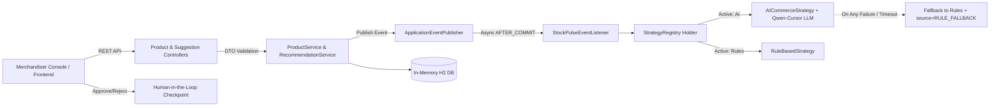

# StockPulse — AI Inventory & Dynamic Pricing Engine

StockPulse is a reactive commerce advisory engine built for online stores (ShopStream). It observes real-time inventory and demand velocity signals, reasons using a unified AI strategy (or deterministic rule-based engine), and queues actionable recommendations for human merchandisers to approve or reject. 

**Core Principle**: The system **NEVER** auto-publishes prices or places automated orders. A human merchandiser is always in the loop.

---

## Architecture Overview



---

## Prerequisites

- **Java**: JDK 17 or JDK 21
- **Maven**: Maven wrapper (`./mvnw`) included in repository
- **Node.js**: Node 18+ (for the frontend console)

---

## Environment Setup (Zero Credential Leakage)

The AI engine uses the **Zycus LiteLLM endpoint** (`https://litellm-qc.zycus.net/v1/chat/completions`) with model `qwen-cursor`.

The API key is **strictly read from the environment variable `LLM_API_KEY`**. It is never hardcoded, never logged, and never included in Git commits.

### Setting the Environment Variable:

**Windows (PowerShell):**
```powershell
$env:LLM_API_KEY="your_zycus_api_key_here"
```

**Windows (CMD):**
```cmd
set LLM_API_KEY=your_zycus_api_key_here
```

**Linux / macOS (Bash / Zsh):**
```bash
export LLM_API_KEY="your_zycus_api_key_here"
```

*(Optional)* A root `.env.example` is provided as a template.

---

## Running the Application

### 1. Start Backend (Spring Boot 3, Port 8081)
```bash
cd backend/demo
./mvnw clean spring-boot:run
```
Backend will be live at: `http://localhost:8081`  
H2 Console available at: `http://localhost:8081/h2-console` (JDBC URL: `jdbc:h2:mem:stockpulsedb`, User: `sa`, Password: empty)

### 2. Start Frontend (React 18 + Vite, Port 5173)
```bash
cd frontend
npm install
npm run dev
```
Merchandising Console will be live at: `http://localhost:5173`

---

## Seed Data & APPAREL Category Mathematics

When launched with an empty database, `DataSeeder` initializes 8 realistic products across ELECTRONICS, APPAREL, and HOME.

### Category Average & DEMAND_SPIKE Math

A `DEMAND_SPIKE` event is triggered when:
$$\text{demandVelocity} > 3.0 \times \text{categoryAverageDemandVelocity}$$

For the **APPAREL** category ($N = 5$ products):
1. `PRD-003`: Organic Cotton T-Shirt, stock: 8, threshold: 15, velocity: 12.0 (already below threshold $\rightarrow$ instant low-stock demo)
2. `PRD-008`: Hoodie — Heather Grey, stock: 11, threshold: 12, velocity: 15.0
3. `PRD-004`: Everyday Canvas Tote Bag, velocity: 1.0
4. `PRD-005`: Merino Wool Winter Beanie, velocity: 1.0
5. `PRD-006`: Crew Athletic Performance Socks, velocity: 1.0

- **Initial APPAREL Sum**: $12.0 + 15.0 + 1.0 + 1.0 + 1.0 = 30.0$
- **Initial APPAREL Average**: $30.0 / 5 = 6.00$
- **Initial Spike Threshold**: $3.0 \times 6.00 = 18.00$
- Initially, `PRD-008` velocity is $15.00$ ($15.00 < 18.00$, no spike yet).

#### Order Progression on PRD-008 (Each order bumps velocity by +5.0):
- **After 1st Order**:
  - `PRD-008` velocity becomes $20.00$.
  - New APPAREL Average: $(20.0 + 15.0) / 5 = 7.00$.
  - Spike Threshold: $3.0 \times 7.00 = 21.00$.
  - Result: $20.00 < 21.00$ (no spike yet).
- **After 2nd Order**:
  - `PRD-008` velocity becomes $25.00$.
  - New APPAREL Average: $(25.0 + 15.0) / 5 = 8.00$.
  - Spike Threshold: $3.0 \times 8.00 = 24.00$.
  - Result: **$25.00 > 24.00$ $\rightarrow$ DEMAND_SPIKE triggers!**

---

## 5-Minute Evaluation Walkthrough

Follow this step-by-step sequence to verify the end-to-end reactive loop:

1. **Verify Default Strategy**:
   The engine starts with `AI` as the active strategy (`commerce.strategy.default=AI`).
   ```bash
   curl http://localhost:8081/admin/strategy
   # Response: {"strategy":"AI"}
   ```

2. **Observe Seeded Product (PRD-003)**:
   ```bash
   curl http://localhost:8081/products/3
   # PRD-003 Organic Cotton T-Shirt has stock 8, reorderThreshold 15
   ```

3. **Simulate a Sale on PRD-003 (Trigger A: INVENTORY_LOW)**:
   ```bash
   curl -X POST http://localhost:8081/products/3/orders \
     -H "Content-Type: application/json" \
     -d '{"quantity": 2}'
   ```
   - Order returns `201 Created` instantly ($< 10\text{ms}$).
   - Stock drops to 6 ($< 15$).
   - The decoupled `@Async @TransactionalEventListener(AFTER_COMMIT)` dispatches the event.

4. **Observe Asynchronously Generated AI Suggestions**:
   Wait ~1–2 seconds for the LLM to respond:
   ```bash
   curl http://localhost:8081/pricing-suggestions?status=PENDING
   curl http://localhost:8081/reorder-suggestions?status=PENDING
   ```
   - Notice the rich reasoning, direction (`INCREASE`), confidence score ($\approx 0.85 - 0.95$), and `source: "AI"`.

5. **Human Checkpoint: Approve Pricing Suggestion**:
   ```bash
   curl -X PATCH http://localhost:8081/pricing-suggestions/1 \
     -H "Content-Type: application/json" \
     -d '{"status": "ACCEPTED"}'
   ```
   - Check product price updated to the recommended price:
   ```bash
   curl http://localhost:8081/products/3
   ```

6. **Trigger Demand Spike on PRD-008 (Trigger B: DEMAND_SPIKE)**:
   Place 2 consecutive simulated orders on product ID 4 (`PRD-008`):
   ```bash
   curl -X POST http://localhost:8081/products/4/orders -H "Content-Type: application/json" -d '{"quantity": 1}'
   curl -X POST http://localhost:8081/products/4/orders -H "Content-Type: application/json" -d '{"quantity": 1}'
   ```
   - `DEMAND_SPIKE` trigger activates asynchronously.
   - Inspect suggestions queue:
   ```bash
   curl http://localhost:8081/pricing-suggestions?status=PENDING
   ```

7. **Runtime Strategy Switching with Zero Downtime**:
   ```bash
   # Switch to rule-based
   curl -X PUT http://localhost:8081/admin/strategy -H "Content-Type: application/json" -d '{"strategy": "RULE_BASED"}'

   # Generate on-demand suggestion
   curl -X POST http://localhost:8081/products/1/suggest-pricing

   # Switch back to AI
   curl -X PUT http://localhost:8081/admin/strategy -H "Content-Type: application/json" -d '{"strategy": "AI"}'
   ```

---

## API Reference & cURL Examples

| Endpoint | Method | Description |
|---|---|---|
| `/products` | `POST` | Create a new catalog product |
| `/products` | `GET` | List products with optional `?status=` and `?category=` |
| `/products/{id}` | `GET` | Get product details by ID |
| `/products/{id}/stock` | `PATCH` | Update stock level directly |
| `/products/{id}/orders` | `POST` | Simulate a customer sale (decrements stock, bumps velocity) |
| `/products/{id}/suggest-pricing` | `POST` | Generate on-demand pricing suggestion (`triggerReason=MANUAL`) |
| `/products/{id}/suggest-reorder` | `POST` | Generate on-demand reorder suggestion (`triggerReason=MANUAL`) |
| `/pricing-suggestions` | `GET` | List pricing suggestions (`?status=PENDING`) |
| `/pricing-suggestions/{id}` | `PATCH` | Accept or reject a pricing suggestion (`ACCEPTED` \| `REJECTED`) |
| `/reorder-suggestions` | `GET` | List replenishment suggestions (`?status=PENDING`) |
| `/reorder-suggestions/{id}` | `PATCH` | Accept or reject a reorder suggestion (`ACCEPTED` \| `REJECTED`) |
| `/admin/strategy` | `GET` | View active commerce strategy |
| `/admin/strategy` | `PUT` | Switch active commerce strategy (`RULE_BASED` \| `AI`) |

### Example cURL Commands:

```bash
# 1. Create a Product
curl -X POST http://localhost:8081/products \
  -H "Content-Type: application/json" \
  -d '{"sku":"DEMO-1","name":"Smart Speaker","category":"ELECTRONICS","currentPrice":89.99,"stockLevel":15,"reorderThreshold":10,"demandVelocity":3.0}'

# 2. Simulate Sale
curl -X POST http://localhost:8081/products/1/orders \
  -H "Content-Type: application/json" \
  -d '{"quantity": 5}'

# 3. Direct Stock Adjustment
curl -X PATCH http://localhost:8081/products/1/stock \
  -H "Content-Type: application/json" \
  -d '{"stockLevel": 25}'

# 4. Resolve Pricing Suggestion
curl -X PATCH http://localhost:8081/pricing-suggestions/1 \
  -H "Content-Type: application/json" \
  -d '{"status":"ACCEPTED"}'

# 5. Resolve Reorder Suggestion (Inbound shipment simulation)
curl -X PATCH http://localhost:8081/reorder-suggestions/1 \
  -H "Content-Type: application/json" \
  -d '{"status":"ACCEPTED"}'

# 6. Switch Active Strategy
curl -X PUT http://localhost:8081/admin/strategy \
  -H "Content-Type: application/json" \
  -d '{"strategy":"AI"}'
```

---

## Running the Automated Test Suite

Run the full suite of unit and integration tests with:
```bash
cd backend/demo
./mvnw test
```
All 28 tests will execute, including:
- Unit tests for deterministic rules (`RuleBasedStrategyTest`)
- Unit tests for AI parsing, markdown stripping, bounds validation & fallback (`AICommerceStrategyTest`)
- Concurrency & race-condition idempotency tests (`IdempotencyTest`)
- Asynchronous agentic event loop integration tests (`AgenticLoopIntegrationTest`)
- REST API validation, stock, order simulation, and resolution tests (`ProductControllerTest`, `Phase2ControllerIntegrationTest`)
